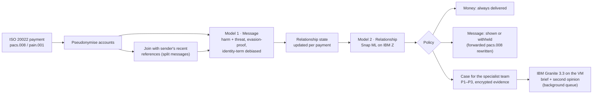

# SafePay: stopping abuse hidden in payment messages, in real time, on IBM Z

**IBM Z Datathon 2026 · Event code: SSF2026 · Theme 1: Real-Time AI for Critical Decisions** (with Theme 2: sensitive data stays on-platform)

> Individual entry by Suhas Adiga. Submission title: `Suhas Adiga_IBM Z Datathon 2026 Project`

## The problem

When a victim blocks an abuser on their phone and every social app, some abusers find the one channel that can't be blocked: **the victim's bank account**. They send one-cent payments with threats in the payment reference.

- **Commonwealth Bank of Australia** found about **1,500 high-risk cases a year**, and built and open-sourced a model to find them ([paper](https://arxiv.org/abs/2303.08016), [code](https://github.com/h2oai/aitd)). That model scores relationships **once a month**.
- **Westpac** reported blocking **24,000 payments from 19,000 customers** over abusive wording.
- **Santander** described a single threat spread **across nine transfers**, and admitted that banned-word lists don't stop determined senders ([report](https://todaysfamilylawyer.co.uk/santander-leads-ban-on-offensive-language-after-reports-that-abusers-are-using-banking-apps-to-send-death-threats/)).
- **Nationwide and Starling** now let customers hide abusive references ([FStech](https://www.fstech.co.uk/fst/Nationwide_Launches_Tool_To_Block_Abusive_Payment_Reference_Messages.php)).

Keyword filters are easy to evade, and monthly scoring leaves victims exposed for weeks. Most of the world's card and payment processing runs on IBM Z, so that's where screening every payment *as it happens* belongs.

## What SafePay does

SafePay is a screening service a bank puts in its payment flow. It reads real **ISO 20022** payment messages, either `pain.001` at the sender's bank or `pacs.008` at the recipient's bank (which protects a victim even if the abuser banks elsewhere). For every payment it returns a decision in about a millisecond.



| Part | What it does | Why it matters |
|---|---|---|
| **Message model** | TF-IDF (words + characters) with two logistic-regression heads: *harm* and *threat*. Trained on 260K real comments. | About 1 ms per message, and every flag points at the words that caused it |
| **Evasion handling** | Undoes `k.i.l.l`, `d3ad`, `k i l l`, Cyrillic look-alikes and 🔪 emoji before scoring | This is how abusers get past keyword lists |
| **Split messages** | Joins the sender's last references (within 30 minutes) and scores the whole sentence | The nine-transfer threat gets caught as a threat |
| **Relationship model** | 23 features updated in O(1) per payment: penny-payment share, night share, replies, bursts, an escalation detector (CUSUM), contact after the victim hid the sender… Random forest on **IBM Snap ML** | Catches polite-but-menacing coercive control that no text model can see |
| **Policy** | **Money is never blocked** (it may be child support). Only the message is withheld. **The sender is never told** once a case exists, because tipping off an abuser can escalate danger. No case on behaviour alone before 3 payments. | Built around victim-safety guidance, not just accuracy |
| **IBM Granite 3.3 2B** | Runs locally on the VM via llama.cpp. Writes a brief for the specialist team, and gives a **second opinion** reading the messages in context | "Saw you at the gym today" scores 0.02 as a toxic message; Granite reads the pattern as stalking |
| **Three views** | Sender's app (pre-send nudge), recipient's app ("Message hidden for your safety · View anyway · Get support", plus "hide messages from this sender", and a discreet **Message settings** screen), analyst console (ranked queue, timeline, Granite brief, the customer's safe-contact rules, confirm/dismiss, audit log) | It's a product, not a notebook |
| **Protect, then Prove** | The victim sets how the bank may contact them safely, and can allow a **signed evidence pack** for police, a protection order or a lawyer: consent per sender, withdrawable, and tamper-evident | Detection alone doesn't help someone get a protection order. Evidence does |

### The victim's side: Protect and Prove

Domestic-violence services stress two things a detector alone doesn't give a victim: **contact on their terms**, and **evidence they can use**. In the recipient's app, behind a neutral "Message settings" tab:

- **Safe contact.** How the bank may reach them (in the app only, phone, email, or not at all), at what times, and whether *someone else may see their phone* (neutral wording only). It's shown first in every case in the analyst console, and stored encrypted, because a note like "my partner checks my phone" is itself sensitive.
- **Quick exit.** One tap, or Esc, instantly replaces the screen with an ordinary account view and removes the safety screen from the page.
- **Support.** 1800RESPECT (1800 737 732, 24/7), emergency 000, and a confidential in-app line to the specialist team.
- **Consent to a record, per sender.** "Allow a record" for police, a protection order or legal advice. It can be withdrawn at any time, after which no new pack can be made.

With that consent, an analyst can prepare a **signed evidence pack**:

| Property | How |
|---|---|
| **Facts, not AI** | The timeline comes from the stored evidence: every payment's time, amount, message, whether it was withheld, and the scores. Granite's brief is attached only as *"AI draft, not checked by a person"*. Model scores are labelled as model outputs, not findings of fact. |
| **The history before the case** | Each relationship keeps its last 20 references (encrypted), so the record starts with the first message, not the moment the case opened. In the coercive-control demo, all 8 messages are there, including the 2 sent before the case opened. |
| **Tamper-evident storage** | The evidence log is a SHA-256 hash chain per case. Editing or deleting any stored row breaks every hash after it, and a pack is refused if the chain doesn't verify. |
| **Tamper-evident pack** | Canonical JSON, a SHA-256 fingerprint and an **Ed25519 signature** with the bank's key. Anyone with the bank's public key can check it. In the demo, adding *one full stop* to one message makes verification fail. |
| **Minimal disclosure** | The victim's safe-contact preferences and notes are never in the pack. Parties appear as the bank's pseudonymous references, which the bank resolves under its own legal process. |
| **Accountable** | Creating and viewing a pack, consent changes and preference changes are all audit-logged. |

## Results

### Real-time vs monthly batch (synthetic test world, seed 10, never used for any decision)

4,481 relationships (6,871 counting each direction), 44,426 payments, 481 abusive. People have several relationships, so victims also get payments from friends, family and landlords, and innocent people sometimes hide senders too. Message text is real (Civil Comments **test** split). The hand-written phrases are a third the models never saw. The baseline re-implements Commonwealth Bank's published method (monthly relationship aggregates, random forest) using **our** message model, so the difference comes from real-time relationship scoring.

| | **SafePay (real-time)** | CBA-style (monthly batch) |
|---|---|---|
| Abusive relationships caught | **452 / 481 (94.0%)** | 465 / 481 (96.7%) |
| False alarms in 6,390 innocent relationships | **0** | 2 |
| **Median time from first abusive payment to case** | **3.3 days** | **19.3 days** |
| Caught within 24 hours | **18.1%** | 1.3% |
| Abusive messages withheld *as they arrived* | **92.0%** | 0% (it only acts after the month) |
| Innocent messages withheld (soft hide; recipient can view) | 2.8% | 0% |

By type, SafePay caught 100% of harassment, split-threat and coercive-control relationships, 93% of abusive child-support payers, 84% of switched accounts (below) and 80% of "low and slow" abusers. **Its weak spot is abusive child-support payers:** their payments come fortnightly or monthly, so the evidence takes weeks to build (median 58 days to a case), and the monthly baseline catches all of them. SafePay still withholds 64% of their abusive messages as they arrive, because the message model doesn't wait for the pattern.

> **Read this honestly.** Zero false alarms in 6,390 is a property of a synthetic world we built, and real data will be harder; the next section tests this at a realistic scale. The comparison that should hold up is *timing*: scoring every payment as it arrives protects victims weeks sooner than a monthly batch, and withholds most abusive messages before they're ever seen.

### Stress-testing our own simulator

We made the simulated world harder in three ways, and each one taught us something.

**1. A more realistic population exposed a shortcut.** In earlier versions every relationship had two brand-new people, and only victims ever hid anyone. Now each party is someone already in the world half the time, and innocent people hide senders too (someone tired of loan reminders, friends who fell out). The previous model, scored on these worlds, raised **9–12 false alarms per ~4,800 innocent relationships**. 8 of the 9 we inspected were friends who had hidden each other, with harmless messages like "groceries split": the model had learned *"a hide means abuse"*. Retrained on the new worlds: 0 on the test world.

**2. Account switching.** Hidden by the victim, the abuser carries on from a new account or a friend's, up to three times. Each new account is a stranger with no history.

| Switched accounts (test world, 81 new-account relationships) | Result |
|---|---|
| Caught | 84% (median 40 hours after the new account's first payment) |
| Their messages withheld, model only | 72%. The first two payments get through, because a case needs 3 payments on behaviour alone |
| Withheld with **protect-after-hide** (below) | **99%** |
| Innocent relationships touched by protect-after-hide | 17 of 6,390 (0.3%), soft hide only, no investigation |

We first tried teaching the *model* about the recipient's side (whether the victim recently hid someone, how soon a new sender appeared, how many new senders since). It made **no measurable difference**: 84% caught at 40 hours with these signals, 85% at 41 hours without. Rules fixed in advance picked between the two versions on validation; they tied, and the tie-break (fewer validation false alarms, 0 vs 2) kept the version with the signals. So the fix is **policy, not the model**. For 14 days after a customer hides someone, messages from brand-new senders they have never paid back are hidden by default, with one tap to view. That extends the victim's own choice to the abuser's next account.

**3. A realistic share of abusers.** In the test world 7% of relationships are abusive; in real banking it's a tiny fraction, so even rare false alarms could swamp real cases. We replayed a separate world of **305,163 innocent relationships (1.7 million payments)** through the final model and policy:

| 305,163 innocent relationships, 1,703,849 payments | Result |
|---|---|
| False alarms (cases opened) | **15**: 0.49 per 10,000 (95% interval 0.28–0.81) |
| Where they came from | 12 friends, 2 debt reminders, 1 couple |
| Innocent messages soft-hidden | 3.0% (protect-after-hide adds 0.05 points; it touched 462 relationships, 0.15%) |

| If this share of relationships were abusive | Cases that are real abuse | Worst case (95% interval) |
|---|---|---|
| 1 in 100 | 99.5% | 99.2% |
| 1 in 1,000 | 95.0% | 92.1% |
| 1 in 10,000 | **65.7%** | 53.7% |

(Using the test world's 94.0% catch rate.) So at a realistic 1 in 10,000, about one case in three would be a false alarm, roughly one extra review for every two real cases. That's in line with what Commonwealth Bank reports on real data (35 of its top 50 confirmed, 70%). It's workable because a false alarm costs a human review and some soft-hidden messages, never a blocked payment or a contacted customer. The zero false alarms in the 6,390-relationship test world were luck of scale: 15 in 305,163 is the number to plan with.

### Outside check: Commonwealth Bank's production model on our simulator

A model trained on our own simulator can always look good on it. So we scored the same test world with **CBA's open-source production model** ([h2oai/aitd](https://github.com/h2oai/aitd)). It was trained on *real*, expert-labelled abuse and has never seen our data. How we ran it is in [`safepay/scripts/cba/`](safepay/scripts/cba/README.md), and the numbers are in [`results/cba_validation.json`](results/cba_validation.json).

| Model (6,774 relationships, 400 abusive) | ROC AUC | PR AUC | Precision in top 50 | Precision in top 400 |
|---|---|---|---|---|
| CBA's model, monthly (best month per relationship) | 0.977 | 0.860 | 100% | 76.0% |
| SafePay | **0.998** | **0.993** | 100% | **98.3%** |
| *For reference: CBA's model on real data, as published* | *0.79–0.80* | | *70% (35/50)* | |

Month by month, CBA's model scored ROC AUC 0.87–0.93 (0.94 for its 3-month model) on our world.

What this tells us:

1. **Our synthetic abuse looks like abuse to a model trained on real abuse.** Without any tuning to our data, CBA's model puts 99% of our harassment and 95% of our split-threat relationships in its top 400. That's an outside sign the simulator's core patterns are realistic.
2. **Our world is easier than reality.** CBA's model does *better* here (AUC ≈ 0.92 per month) than on real data (0.80). That's consistent with our zero false alarms, and it's why we don't claim real-world precision.
3. **The gaps are where we expected.** Share of each abusive type in each model's top 400:

| Abusive type | n | CBA's model | SafePay |
|---|---|---|---|
| Harassment | 131 | 99% | 100% |
| Split threats | 79 | 95% | 100% |
| Coercive control (polite, menacing) | 93 | 69% | 100% |
| Abusive child-support payers (legitimate amounts) | 43 | 47% | 95% |
| Low and slow (few payments) | 54 | 28% | 91% |

A text-led monthly model misses abuse that hides behind polite words, legitimate amounts or low volume. Those are the cases SafePay's behaviour features target. **Caveats:** SafePay was trained on this simulator and CBA's model wasn't, so part of SafePay's lead is home advantage. And this check used the v4 simulator and model; the CBA pipeline was run once, on that world. What carries weight is CBA's model independently recognising the abusive patterns, and which types it struggles with.

### How we got here (development history, kept on purpose)

| Version | Test world | Precision | False alarms /10K innocent | What we found |
|---|---|---|---|---|
| v1 | seed 3 | 70% | 251 | The model memorised the exact scores of a few hand-written innocent phrases. Validation reused training phrases, so it looked perfect (F1 0.99) and hid this |
| v2 | seed 4 | 80% | 156 | Fixed with a three-way phrase split, a score floor and phrase variation. Then friends' banter tripped it, because the test phrases were ruder than the training ones |
| v3 | seed 5 | 100% | 0 | Broader banter in every split of the phrase lists. Median time to case 1.7 days |
| v4 | seed 5 | 100% | 0 | Two realism rules prompted by the *live demo*, not by test scores: no behaviour-only case before 3 payments (one 1 a.m. penny payment scored 0.71), and references under 4 letters judged only as part of joined text ("I" scored 0.96 as a threat). They made test timing *worse* (median 1.7 → 3.2 days) and we kept them |
| v4 on harder worlds | seeds 2, 9 | – | 19–25 | People with several relationships and innocent hides: the model had learned "a hide means abuse" (see the stress test above) |
| **final** | seed 10 | **100%** | **0** | Retrained on the realistic population, with account switching and recipient-side signals, plus the protect-after-hide policy. Catches slightly fewer than the monthly baseline (94.0% vs 96.7%) |

Seeds 3, 4 and 9 were used for diagnosis. Seed 5 was evaluated twice, for v3 and v4, and the change between them was not chosen to improve its numbers. The final model was chosen on validation and scored once on seed 10. Every version's metrics are in `results/`.

### Does IBM Granite's second opinion help?

Granite reads a relationship's facts and messages and answers one question: is this harassment, stalking or coercive control? It does **not** see the risk model's score, so the opinion is independent. We generate a single token (Yes/No) and use the probability Granite gives "Yes" as its score. That's both faster and measurable.

**Setup** (run with the v4 model and simulator). Each evaluation uses a world no model was trained on. It includes every relationship Granite could change, plus 30 controls:
- **Near misses:** not flagged, scoring within 0.2 below the case threshold, with at least 3 payments.
- **Weak cases:** flagged, but with no abusive words.

Two rules were fixed before seeing any output:
- **Rescue:** a near miss becomes a case if Granite says ≥ 50%.
- **Dismiss:** a weak case is dropped if Granite says < 20%.

| Prompt | Cases from | Granite ROC AUC | Accuracy | Risk-model AUC, same cases | Friends' banter, mean p | Rescue rule: extra abusive caught / extra false alarms |
|---|---|---|---|---|---|---|
| v1 | seed 6 (development) | 0.907 | 73% | 0.957 | **0.59** | +3 / +7 |
| v2 | seed 6 (development) | 0.912 | 82% | 0.955 | 0.24 | +1 / +2 |
| v2 | **seed 7 (fresh)** | **0.989** | **93%** | 0.933 | 0.12 | **+5 / +1** |

What we learned:
- **v1 read rude banter as abuse.** "Dinner, you pig" between friends averaged 59%, and the rescue rule would have tripled false alarms. Prompt v2 states whether the relationship is two-way and tells Granite to judge the pattern, not the words.
- **On the fresh world, v2 rescued all 5 abusive near misses for 1 extra false alarm** (382 → 387 caught of 400). On the development world it helped less (+1 / +2). Across both: +6 caught for +3 false alarms, from only 10 abusive near misses. **That's too few to trust Granite with decisions,** so SafePay keeps it advisory: it explains cases, and its probability is shown to analysts.
- **It reads intent well where words mislead.** Debt reminders ("still waiting on the loan") average **0.00**, while coercive control averages **0.996**, even though the toxicity model scores both as harmless (0.05 and 0.08).

**Speed on 3 shared IBM Z cores:**

| | Before | After |
|---|---|---|
| Second opinion | ~60 s (JSON with a sentence) | **11 s** (one token), **0.9 s** when the prompt is cached |
| Analyst brief | 97 s (110 tokens) | 67–79 s (80 tokens, trimmed to whole sentences) |

Generation runs at about 1.2 tokens/s, which is the real limit here. So we cut the tokens, put the fixed instructions first so llama.cpp reuses its cached prompt work, and kept Granite off the payment path.

### Message model on real held-out text (Civil Comments test split, payment-length texts ≤ 140 characters)

| Head | Texts | Positives | Precision | Recall | F1 | ROC AUC |
|---|---|---|---|---|---|---|
| Harm | 36,220 | 2,883 | 0.682 | 0.684 | 0.683 | 0.956 |
| Threat | 36,220 | 151 | 0.312 | 0.503 | 0.385 | 0.974 |

Threats are rare and hard to pin down from text alone. That's exactly why the relationship model and Granite exist.

**Evasion tricks** (applied to the 5,223 toxic test texts): recall is 67.0% clean, 61.3% after tricks without our canonicaliser, and **66.7%** with it, so it recovers about 95% of what the tricks take away.

**Fairness** (Jigsaw identity templates, never used for training). Our first model hid harmless messages just for mentioning a group:

| Harmless sentences mentioning… | Before identity masking | After |
|---|---|---|
| "gay" | **99.7%** flagged | 13.2% |
| "homosexual" | 96.8% | ≤ 13.2% |
| "black" | 88.6% | ≤ 13.2% |
| "muslim" | 76.2% | ≤ 13.2% |
| Toxic template sentences caught | 80.7% | **97.4%** |

13.2% is now the same as for any template sentence, so no identity term is singled out. It cost 0.013 F1 on real text.

## Why IBM Z / LinuxONE (measured on an IBM z17, machine type 9175)

| | Result |
|---|---|
| Full screening path in one process (message → joined → state → relationship → policy → encrypt state → SQLite write) | **933 payments/s**, median 0.27 ms, p99 5.9 ms (earlier runs with the previous model: 922/s, and 699/s before state encryption; runs vary on this shared VM) |
| Same, over HTTP with real ISO 20022 XML | **577 requests/s**, median 0.77 ms, p99 6.7 ms |
| Relationship model, Snap ML compressed trees on CPU | **11 µs** per payment |
| Relationship model, Snap ML on the **on-chip AI accelerator** (zDNN) | 61–97 µs per payment |
| IBM Granite 3.3 2B, Q4_K_M, on the CPU's vector units, 3 threads | 11.8 prompt tokens/s, 1.34 generated tokens/s. With the lab notebook container also running on the 8 GB VM: about 4–7 and 0.4 (about 220 s per brief), as Linux evicts the memory-mapped model |

- **We measured instead of assuming.** The VM exposes the Telum II AI accelerator (`nnpa` in `/proc/cpuinfo`), and Snap ML's automatic choice picks it. For our small forest on this shared 3-core VM, the CPU engine was 5× faster, so the service uses whichever engine the benchmark measured as fastest (`artifacts/benchmark.json`). The accelerator path is one setting away for larger models.
- **Big-endian, natively.** The stack runs on Ubuntu's native s390x builds of numpy, SciPy and scikit-learn, because PyPI has no s390x wheels for them. Granite's GGUF file was converted to big-endian with llama.cpp's converter.
- **H2O's model scorer isn't big-endian safe.** Scoring CBA's H2O MOJO models on s390x fails: a tree split on feature 33 (`0x0021`) is read as 8448 (`0x2100`), with `ArrayIndexOutOfBoundsException: Index 8448 out of bounds for length 53`. The same jar and model score fine on x86, so that one step ran on x86. It's a real portability issue for banks moving H2O models onto IBM Z.
- **Toolchain notes we hit.** Ubuntu 24.04's GCC 13 can't target the z17 (`-march=arch15` needs GCC 15), so llama.cpp is built for z16, which the z17 runs natively. llama.cpp's own zDNN backend only accelerates FP16/FP32 models, and Granite in FP16 (~5 GB) doesn't fit beside everything else in 8 GB RAM, so Granite runs on the vector units.
- **Data never leaves the platform.** Models, Granite, the case store and the audit log all run on the same LinuxONE system. Account numbers are replaced by keyed HMAC tokens on arrival. Message text is encrypted with AES-256-GCM everywhere it's stored (evidence, relationship state, victim preferences), each ciphertext bound to its record. Evidence packs are signed with Ed25519. There's no external AI API.
- **Where IBM Z's hardware would take over in production.** The AES and HMAC keys and the Ed25519 signing key are files on this VM. A bank would keep them in a hardware security module, such as IBM Z's Crypto Express adapters, so even administrators can't export the key that signs evidence for court.
- **Containerised.** The `Containerfile` builds an s390x image with Podman.
- **Granite stays off the payment path.** At 1.3 tokens/s on 3 shared cores, a brief takes 1–2 minutes, so Granite runs in a background queue, and is re-run when a case escalates to P1.

## Security

| Threat | What SafePay does |
|---|---|
| Malicious XML (entity expansion, external entities) | ISO 20022 never needs a DTD, so any message with a `<!DOCTYPE` or `<!ENTITY` is refused before parsing. Messages over 1 MB or 1,000 transactions are refused too |
| Anyone calling the bank-facing API | `SAFEPAY_MODE=production` requires an API key (`X-API-Key`) for screening, pre-send checks and recipient choices, compared in constant time |
| A forged identity in the audit log | In production, the analyst's name comes from their personal token (`X-Analyst-Token`), never from a header the caller sets. A test checks that a request claiming to be "mallory" is logged under the token's owner |
| The demo left on in production | Production mode removes every demo page and `/demo` endpoint (404), plus the API docs |
| Floods and expensive requests | Rate limits per client and route (e.g. 6 resets or 20 scenario replays a minute), and a cap of 4 queued Granite briefs; more are refused with 429, not queued |
| Clickjacking and content injection | Content Security Policy, `X-Frame-Options: DENY`, `nosniff`, `no-referrer`, and no caching. Everything the pages show from the API is set with `textContent`, never as HTML |
| Data at rest | Message text, relationship state and victim preferences encrypted with AES-256-GCM; account numbers replaced by HMAC tokens; evidence hash-chained; packs signed with Ed25519 |
| Secrets | Keys, tokens and the demo password live in `~/.safepay/` (mode 600), outside the repository, created by `python3 -m safepay.scripts.make_keys`. Granite only listens on 127.0.0.1 |

Pack verification (`/v1/packs/verify`, `/v1/evidence/public-key`) stays open in every mode, so police and courts can check a pack without an account. The tests cover each row above.

### Live demo

`bash run_safepay.sh public` serves the demo on port 8090 behind a password (user `judge`), with the stricter public rate limits. The password is in `~/.safepay/demo_password` on the VM. The VM's firewall only allows SSH by default, so the port has to be opened separately.

**Link: http://148.100.76.164:8090** (user `judge`; the password is in the submission). The analyst console is at `/analyst` and the evidence page at `/system`. The demo runs over plain HTTP, so the demo password is the only secret that crosses the network, and the demo holds only fictional data.

## What is real and what is simulated

| Real | Simulated (and why) |
|---|---|
| ISO 20022 pacs.008 / pain.001 parsing and the forwarded message | The bank itself: no hackathon can connect to one, so SafePay speaks the industry format |
| Message text: 1.14M real short comments (Civil Comments, CC0) | **Abusive relationship timelines.** No public dataset of real abusive payments exists, and one shouldn't, because it would expose victims. Patterns follow what banks have published |
| Live demo input: whatever you type is screened by the real service | Customer names and accounts (fictional) |
| Snap ML, zDNN, Granite and llama.cpp running on the z17 | Hand-written payment-style, banter, coercive and debt-reminder phrases, split in thirds across train/validation/test |

## Run it

On a LinuxONE Community Cloud VM (Ubuntu 24.04, s390x). Civil Comments comes as Parquet, and pyarrow has no s390x build, so convert it once on any other machine with `python -m safepay.scripts.convert_parquet <parquet dir> data/`, then copy `cc_*.csv` to `data/`.

```bash
bash setup_safepay.sh      # packages, train, evaluate, build llama.cpp, convert Granite, tests
bash run_safepay.sh        # Granite on :8081, SafePay on :8090
python3 -m safepay.scripts.benchmark --url http://127.0.0.1:8090 --granite
```

From your laptop:

```bash
ssh -N -L 8090:127.0.0.1:8090 linux1@<vm-ip>
```

Then open http://localhost:8090 (live demo, with five scenarios including **Hidden, then switches account**; the recipient's **Message settings** tab is the victim's side), `/analyst` (specialist console, where a case with consent offers **Prepare signed evidence pack**), `/pack/{id}` (the printable pack, with Verify and Simulate tampering), and `/system` (every number above, read from the training and benchmark outputs).

Container: `podman build -t safepay -f Containerfile . && bash run_safepay.sh container`

Modes: `bash run_safepay.sh` (local demo), `bash run_safepay.sh public` (password-protected public demo), `bash run_safepay.sh production` (no demo; API keys and analyst tokens required).

Tests: `python3 -m pytest -q tests_safepay` (24 tests; the two end-to-end ones need trained models). They cover the hash chain catching edits and deletions, pack signatures rejecting a one-character change or another key, consent gating and withdrawal, and that no message text or preference is readable in the database.

### API

| Endpoint | Who calls it |
|---|---|
| `POST /v1/screen` | Payment flow: body is an ISO 20022 `pacs.008` or `pain.001`. Returns per transaction: decision, scores, reasons, case, latency, and the `pacs.008` to forward |
| `POST /v1/presubmit` | Sender's app before sending: `{nudge, message}`. Never reveals that a case exists |
| `POST /v1/recipients/hide` | Recipient's app: hide messages from this sender |
| `GET /v1/cases`, `GET /v1/cases/{id}` | Analyst console (decrypts evidence and writes the audit log) |
| `POST /v1/cases/{id}/label` | Confirm or dismiss, stored as labels for retraining |
| `POST /v1/recipients/preferences` | Recipient's app: safe-contact preferences (stored encrypted) |
| `POST /v1/recipients/consent` | Recipient's app: allow or withdraw an evidence record for one sender and purpose |
| `POST /v1/cases/{id}/evidence-pack` | Analyst: build and sign a pack. `403` without consent, `409` if the evidence log fails its integrity check |
| `GET /v1/packs/{id}` | Analyst: the signed pack (audit-logged) |
| `POST /v1/packs/verify`, `GET /v1/evidence/public-key` | Anyone holding a pack (police, a court): check its fingerprint and signature |
| `GET /healthz`, `GET /metrics` | Operations (Prometheus text format) |

## Project layout

```
safepay/core/iso20022.py    parse/build pacs.008 and pain.001, rewrite the reference
safepay/core/normalize.py   undo evasion tricks
safepay/core/textmodel.py   Model 1: harm + threat heads, identity-term masking
safepay/core/state.py       per-relationship state, split-message buffer, CUSUM
safepay/core/engine.py      shared scoring path for training, evaluation and the service
safepay/core/relmodel.py    Model 2 on Snap ML (CPU or AI accelerator)
safepay/core/policy.py      decisions: deliver, hide, case, nudge
safepay/core/screener.py    the live service pipeline
safepay/core/privacy.py     HMAC tokens, AES-GCM for evidence, state and preferences
safepay/core/store.py       SQLite: states, cases, hash-chained evidence, consent, packs, labels, audit
safepay/core/evidence_pack.py  build, sign (Ed25519) and verify evidence packs
safepay/core/granite.py     IBM Granite briefs and second opinions (background)
safepay/sim/world.py        synthetic payment worlds
safepay/scripts/            convert_parquet, train_text, train_rel, benchmark
safepay/app/                FastAPI service + demo, analyst and evidence pages
```

## Limitations and next steps

- **Synthetic relationships.** The next step is a pilot on a bank's own (consented, pseudonymised) payment logs, with the analyst labels SafePay already collects feeding retraining.
- **English only.** CBA's paper lists other languages as an open gap, and Granite's multilingual support is the natural route.
- **Granite's second opinion rests on small samples.** About 50 cases per world and only 10 abusive near misses in total, so it stays advisory (see above).
- **A switched account's first messages rely on a policy, not the model.** Protect-after-hide catches them only if the victim used "hide". An abuser who switches accounts *before* being hidden is a stranger again for his first three payments.
- **Child-support abuse is caught slowly** (median 58 days), because the payments are fortnightly or monthly.
- **A pack's history before the case is the last 20 messages.** A bank would attach the relationship's full payment history from its own records.
- **A signature proves a record wasn't changed, not that it's true.** The pack also depends on the bank resolving pseudonymous references to people. Whether a court accepts it is a legal question for the bank and the victim's lawyer. The support numbers shown are Australian, to match the demo.

## Data and open-source software

| | Licence |
|---|---|
| [google/civil_comments](https://huggingface.co/datasets/google/civil_comments) | CC0-1.0 |
| [conversationai/unintended-ml-bias-analysis](https://github.com/conversationai/unintended-ml-bias-analysis) (bias templates) | Apache-2.0 |
| [IBM Granite 3.3 2B Instruct GGUF](https://huggingface.co/ibm-granite/granite-3.3-2b-instruct-GGUF) | Apache-2.0 |
| [llama.cpp](https://github.com/ggml-org/llama.cpp) | MIT |
| [IBM zDNN](https://github.com/IBM/zDNN) | Apache-2.0 |
| [IBM Snap ML](https://snapml.readthedocs.io/) | Free IBM licence (not open source) |
| [scikit-learn](https://github.com/scikit-learn/scikit-learn), [NumPy](https://github.com/numpy/numpy), [SciPy](https://github.com/scipy/scipy), [pandas](https://github.com/pandas-dev/pandas), [joblib](https://github.com/joblib/joblib) | BSD-3 |
| [FastAPI](https://github.com/fastapi/fastapi), [Pydantic](https://github.com/pydantic/pydantic), [pytest](https://github.com/pytest-dev/pytest) | MIT |
| [Uvicorn](https://github.com/encode/uvicorn), [HTTPX](https://github.com/encode/httpx) | BSD-3 |
| [cryptography](https://github.com/pyca/cryptography) | Apache-2.0 / BSD |
| [Apache Arrow (pyarrow)](https://github.com/apache/arrow), used once to convert Parquet | Apache-2.0 |
| [Podman](https://github.com/containers/podman) | Apache-2.0 |
| [CBA / H2O.ai AITD model and pipeline](https://github.com/h2oai/aitd), used only for the outside check | Apache-2.0 |
| [Detoxify](https://github.com/unitaryai/detoxify) checkpoint `toxic_bias-4e693588`, [distilbert-base-uncased-emotion](https://huggingface.co/bhadresh-savani/distilbert-base-uncased-emotion), [VADER](https://github.com/cjhutto/vaderSentiment), [wordninja](https://github.com/keredson/wordninja), [PyTorch](https://github.com/pytorch/pytorch), [Transformers](https://github.com/huggingface/transformers), used only for the outside check | Apache-2.0 / MIT / BSD |
| [IBM Plex](https://github.com/IBM/plex) fonts | OFL-1.1 |
