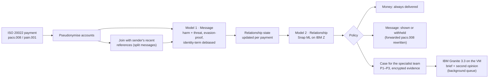

# SafePay: stopping abuse hidden in payment messages, in real time, on IBM Z

**IBM Z Datathon 2026 · Event code: SSF2026 · Theme 1: Real-Time AI for Critical Decisions** (with Theme 2: sensitive data stays on-platform)

> Individual entry by Suhas Adiga. Submission title: `Suhas Adiga_IBM Z Datathon 2026 Project`

## The problem

When a victim blocks an abuser on their phone and every social app, some abusers find the one channel that can't be blocked: **the victim's bank account**. They send one-cent payments with threats in the payment reference.

- **Commonwealth Bank of Australia** found about **1,500 high-risk cases a year**, and built and open-sourced a model to find them ([paper](https://arxiv.org/abs/2303.08016), [code](https://github.com/h2oai/aitd)). That model scores relationships **once a month**.
- **Westpac** reported blocking **24,000 payments from 19,000 customers** over abusive wording.
- **Santander** described a single threat spread **across nine transfers**, and admitted that banned-word lists don't stop determined senders ([report](https://todaysfamilylawyer.co.uk/santander-leads-ban-on-offensive-language-after-reports-that-abusers-are-using-banking-apps-to-send-death-threats/)).
- **Nationwide and Starling** now let customers hide abusive references ([FStech](https://www.fstech.co.uk/fst/Nationwide_Launches_Tool_To_Block_Abusive_Payment_Reference_Messages.php)).

Keyword filters are easy to evade, and monthly scoring leaves victims exposed for weeks. Most of the world's card and payment processing runs on IBM Z, so that's where screening every payment *as it happens* belongs.

## What SafePay does

SafePay is a screening service a bank puts in its payment flow. It reads real **ISO 20022** payment messages, either `pain.001` at the sender's bank or `pacs.008` at the recipient's bank (which protects a victim even if the abuser banks elsewhere). For every payment it returns a decision in about a millisecond.



| Part | What it does | Why it matters |
|---|---|---|
| **Message model** | TF-IDF (words + characters) with two logistic-regression heads: *harm* and *threat*. Trained on 260K real comments. | About 1 ms per message, and every flag points at the words that caused it |
| **Evasion handling** | Undoes `k.i.l.l`, `d3ad`, `k i l l`, Cyrillic look-alikes and 🔪 emoji before scoring | This is how abusers get past keyword lists |
| **Split messages** | Joins the sender's last references (within 30 minutes) and scores the whole sentence | The nine-transfer threat gets caught as a threat |
| **Relationship model** | 23 features updated in O(1) per payment: penny-payment share, night share, replies, bursts, an escalation detector (CUSUM), contact after the victim hid the sender… Random forest on **IBM Snap ML** | Catches polite-but-menacing coercive control that no text model can see |
| **Policy** | **Money is never blocked** (it may be child support). Only the message is withheld. **The sender is never told** once a case exists, because tipping off an abuser can escalate danger. No case on behaviour alone before 3 payments. For 14 days after a customer hides someone, messages from brand-new senders are hidden by default (**protect-after-hide**), so an abuser's next account is covered too. | Built around victim-safety guidance, not just accuracy |
| **IBM Granite 3.3 2B** | Runs locally on the VM via llama.cpp. Writes a brief for the specialist team, and gives a **second opinion** reading the messages in context | "Saw you at the gym today" scores 0.02 as a toxic message; Granite reads the pattern as stalking |
| **Three views** | Sender's app (pre-send nudge), recipient's app ("Message hidden for your safety · View anyway · Get support", plus "hide messages from this sender", and a discreet **Message settings** screen), analyst console (ranked queue, timeline, Granite brief, the customer's safe-contact rules, confirm/dismiss, audit log) | It's a product, not a notebook |
| **Protect, then Prove** | The victim sets how the bank may contact them safely, and can allow a **signed evidence pack** for police, a protection order or a lawyer | Detection alone doesn't help someone get a protection order. Evidence does |

### The victim's side: Protect and Prove

In the recipient's app, behind a neutral "Message settings" tab:

- **Safe contact.** How the bank may reach them (in the app only, phone, email, or not at all), at what times, and whether *someone else may see their phone* (neutral wording only). It's shown first in every case in the analyst console, and stored encrypted.
- **Quick exit.** One tap, or Esc, instantly replaces the screen with an ordinary account view.
- **Support.** 1800RESPECT (1800 737 732, 24/7), emergency 000, and a confidential in-app line to the specialist team.
- **Consent to a record, per sender.** "Allow a record" for police, a protection order or legal advice. It can be withdrawn at any time.

With that consent, an analyst can prepare a **signed evidence pack**:

| Property | How |
|---|---|
| **Facts, not AI** | The timeline comes from the stored evidence: every payment's time, amount, message, whether it was withheld, and the scores. Granite's brief is attached only as *"AI draft, not checked by a person"*. |
| **The history before the case** | Each relationship keeps its last 20 references (encrypted), so the record starts with the first message, not the moment the case opened. |
| **Tamper-evident storage** | The evidence log is a SHA-256 hash chain per case. Editing or deleting any stored row breaks every hash after it, and a pack is refused if the chain doesn't verify. |
| **Tamper-evident pack** | Canonical JSON, a SHA-256 fingerprint and an **Ed25519 signature** with the bank's key. Adding *one full stop* to one message makes verification fail. |
| **Minimal disclosure** | The victim's safe-contact preferences and notes are never in the pack. Parties appear as the bank's pseudonymous references. |
| **Accountable** | Creating and viewing a pack, consent changes and preference changes are all audit-logged. |

## Results

### Real-time vs monthly batch

Synthetic test world (seed 10, never used for any decision): 4,481 relationships (6,871 counting each direction), 44,426 payments, 481 abusive. People have several relationships, abusers switch accounts after being hidden, and innocent people hide senders too. Message text is real (Civil Comments **test** split). The baseline re-implements Commonwealth Bank's published method (monthly relationship aggregates, random forest) using the same message model, so the difference comes from real-time relationship scoring.

| | **SafePay (real-time)** | CBA-style (monthly batch) |
|---|---|---|
| Abusive relationships caught | **452 / 481 (94.0%)** | 465 / 481 (96.7%) |
| False alarms in 6,390 innocent relationships | **0** | 2 |
| **Median time from first abusive payment to case** | **3.3 days** | **19.3 days** |
| Caught within 24 hours | **18.1%** | 1.3% |
| Abusive messages withheld *as they arrived* | **92.0%** | 0% (it only acts after the month) |
| Innocent messages withheld (soft hide; recipient can view) | 2.8% | 0% |

By type, SafePay caught 100% of harassment, split-threat and coercive-control relationships, 93% of abusive child-support payers, 84% of switched accounts and 80% of "low and slow" abusers. Abusive child-support payers are the weak spot: their payments are fortnightly or monthly, so the evidence takes weeks to build (median 58 days to a case). SafePay still withholds 64% of their abusive messages as they arrive.

**Switched accounts:** with protect-after-hide, 99% of messages from an abuser's new accounts are withheld (72% from the model alone), touching 17 of 6,390 innocent relationships with a soft hide only.

### At a realistic share of abusers

Zero false alarms in 6,390 is a property of a synthetic world. To plan for real volumes, a separate world of **305,163 innocent relationships (1.7 million payments)** was replayed through the final model and policy:

| | Result |
|---|---|
| False alarms (cases opened) | **15**: 0.49 per 10,000 (95% interval 0.28–0.81) |
| Innocent messages soft-hidden | 3.0% |

| If this share of relationships were abusive | Cases that are real abuse | Worst case (95% interval) |
|---|---|---|
| 1 in 100 | 99.5% | 99.2% |
| 1 in 1,000 | 95.0% | 92.1% |
| 1 in 10,000 | **65.7%** | 53.7% |

At 1 in 10,000, about one case in three would be a false alarm, in line with what Commonwealth Bank reports on real data (35 of its top 50 confirmed, 70%). A false alarm costs a human review and some soft-hidden messages, never a blocked payment or a contacted customer.

### Outside check: Commonwealth Bank's production model

The same kind of world was scored with **CBA's open-source production model** ([h2oai/aitd](https://github.com/h2oai/aitd)), trained on *real*, expert-labelled abuse and never shown this data. Method: [`safepay/scripts/cba/`](safepay/scripts/cba/README.md); numbers: [`results/cba_validation.json`](results/cba_validation.json).

| Model (6,774 relationships, 400 abusive) | ROC AUC | PR AUC | Precision in top 400 |
|---|---|---|---|
| CBA's model, monthly (best month per relationship) | 0.977 | 0.860 | 76.0% |
| SafePay | **0.998** | **0.993** | **98.3%** |
| *For reference: CBA's model on real data, as published* | *0.79–0.80* | | |

CBA's model independently recognises the simulated abuse (99% of harassment and 95% of split threats in its top 400), which is an outside sign the simulator is realistic. It misses what hides behind polite words, legitimate amounts or low volume: coercive control 69% (SafePay 100%), child-support abusers 47% (95%), low and slow 28% (91%). SafePay was trained on this simulator and CBA's model wasn't, so part of the lead is home advantage.

### IBM Granite's second opinion

Granite reads a relationship's facts and messages, without the risk model's score, and answers one question: is this harassment, stalking or coercive control? It generates a single token, and the probability of "Yes" is its score. On a fresh world it scored **ROC AUC 0.989** on the borderline cases, and rescued 5 abusive near misses for 1 extra false alarm. It reads intent where words mislead: debt reminders average **0.00** and coercive control **0.996**, though the toxicity model scores both as harmless. The samples are small, so Granite stays advisory: it explains cases, and its probability is shown to analysts.

### Message model on real held-out text

Civil Comments test split, payment-length texts (≤ 140 characters):

| Head | Texts | Positives | Precision | Recall | F1 | ROC AUC |
|---|---|---|---|---|---|---|
| Harm | 36,220 | 2,883 | 0.682 | 0.684 | 0.683 | 0.956 |
| Threat | 36,220 | 151 | 0.312 | 0.503 | 0.385 | 0.974 |

- **Evasion:** on 5,223 toxic texts with tricks applied, recall is 66.7% (67.0% clean), so the canonicaliser recovers about 95% of what the tricks take away.
- **Fairness** (Jigsaw identity templates, never used for training): harmless sentences mentioning "gay", "homosexual", "black" or "muslim" are flagged no more often than any template sentence (13.2%), and 97.4% of toxic template sentences are caught.

## Why IBM Z / LinuxONE (measured on an IBM z17, machine type 9175)

| | Result |
|---|---|
| Full screening path in one process (message → joined → state → relationship → policy → encrypt state → SQLite write) | **933 payments/s**, median 0.27 ms, p99 5.9 ms |
| Same, over HTTP with real ISO 20022 XML | **577 requests/s**, median 0.77 ms, p99 6.7 ms |
| Relationship model, Snap ML compressed trees on CPU | **11 µs** per payment |
| Relationship model, Snap ML on the **on-chip AI accelerator** (zDNN) | 61–97 µs per payment |
| IBM Granite 3.3 2B, Q4_K_M, on the CPU's vector units, 3 threads | 11.8 prompt tokens/s, 1.34 generated tokens/s; second opinion 11 s (0.9 s with a cached prompt), brief 67–79 s |

- **Measured, not assumed.** The VM exposes the Telum II AI accelerator, and Snap ML picks it by default. For this small forest on 3 shared cores the CPU engine was 5× faster, so the service uses whichever engine the benchmark measured as fastest (`artifacts/benchmark.json`).
- **Big-endian, natively.** Ubuntu's native s390x builds of numpy, SciPy and scikit-learn; Granite's GGUF file converted to big-endian with llama.cpp's converter; llama.cpp built for z16, which the z17 runs natively.
- **Data never leaves the platform.** Models, Granite, the case store and the audit log all run on the same LinuxONE system. Account numbers are replaced by keyed HMAC tokens on arrival. Message text is encrypted with AES-256-GCM everywhere it's stored. Evidence packs are signed with Ed25519. There's no external AI API.
- **In production,** the AES, HMAC and Ed25519 keys would live in a hardware security module such as IBM Z's Crypto Express adapters, so even administrators can't export the key that signs evidence for court.
- **Granite stays off the payment path.** It runs in a background queue, and is re-run when a case escalates to P1.
- **Containerised.** The `Containerfile` builds an s390x image with Podman.

## Security

| Threat | What SafePay does |
|---|---|
| Malicious XML (entity expansion, external entities) | Any message with a `<!DOCTYPE` or `<!ENTITY` is refused before parsing, as are messages over 1 MB or 1,000 transactions |
| Anyone calling the bank-facing API | `SAFEPAY_MODE=production` requires an API key (`X-API-Key`), compared in constant time |
| A forged identity in the audit log | In production, the analyst's name comes from their personal token (`X-Analyst-Token`), never from a header the caller sets |
| The demo left on in production | Production mode removes every demo page and `/demo` endpoint (404), plus the API docs |
| Floods and expensive requests | Rate limits per client and route, and a cap of 4 queued Granite briefs; more are refused with 429 |
| Clickjacking and content injection | Content Security Policy, `X-Frame-Options: DENY`, `nosniff`, `no-referrer`, no caching; API data is rendered with `textContent`, never as HTML |
| Data at rest | AES-256-GCM for messages, relationship state and victim preferences; HMAC tokens for accounts; hash-chained evidence; Ed25519-signed packs |
| Secrets | Keys, tokens and the demo password live in `~/.safepay/` (mode 600), outside the repository, created by `python3 -m safepay.scripts.make_keys`. Granite only listens on 127.0.0.1 |

Pack verification (`/v1/packs/verify`, `/v1/evidence/public-key`) stays open in every mode, so police and courts can check a pack without an account.

## Live demo

**http://148.100.99.226:8090** (user `judge`; the password is in the submission). The analyst console is at `/analyst` and the evidence page at `/system`. The demo holds only fictional data.

## What is real and what is simulated

| Real | Simulated (and why) |
|---|---|
| ISO 20022 pacs.008 / pain.001 parsing and the forwarded message | The bank itself: SafePay speaks the industry format instead |
| Message text: 1.14M real short comments (Civil Comments, CC0) | **Abusive relationship timelines.** No public dataset of real abusive payments exists, and one shouldn't, because it would expose victims. Patterns follow what banks have published |
| Live demo input: whatever you type is screened by the real service | Customer names and accounts (fictional) |
| Snap ML, zDNN, Granite and llama.cpp running on the z17 | Hand-written payment-style, banter, coercive and debt-reminder phrases, split in thirds across train/validation/test |

## Run it

On a LinuxONE Community Cloud VM (Ubuntu 24.04, s390x). Civil Comments comes as Parquet, and pyarrow has no s390x build, so convert it once on any other machine with `python -m safepay.scripts.convert_parquet <parquet dir> data/`, then copy `cc_*.csv` to `data/`.

```bash
bash setup_safepay.sh      # packages, train, evaluate, build llama.cpp, convert Granite, tests
bash run_safepay.sh        # Granite on :8081, SafePay on :8090
python3 -m safepay.scripts.benchmark --url http://127.0.0.1:8090 --granite
```

From your laptop:

```bash
ssh -N -L 8090:127.0.0.1:8090 linux1@<vm-ip>
```

Then open http://localhost:8090 (live demo with five scenarios; the recipient's **Message settings** tab is the victim's side), `/analyst` (specialist console, with **Prepare signed evidence pack** for cases with consent), `/pack/{id}` (the printable pack, with Verify and Simulate tampering), and `/system` (every number above, read from the training and benchmark outputs).

Modes: `bash run_safepay.sh` (local demo), `public` (password-protected public demo on 0.0.0.0; port 8090 must be open in the VM firewall), `production` (no demo; API keys and analyst tokens required), `container` (after `podman build -t safepay -f Containerfile .`).

Tests: `python3 -m pytest -q tests_safepay` (33 tests). They cover the hash chain catching edits and deletions, pack signatures rejecting a one-character change or another key, consent gating and withdrawal, the security controls above, and that no message text or preference is readable in the database.

### API

| Endpoint | Who calls it |
|---|---|
| `POST /v1/screen` | Payment flow: body is an ISO 20022 `pacs.008` or `pain.001`. Returns per transaction: decision, scores, reasons, case, latency, and the `pacs.008` to forward |
| `POST /v1/presubmit` | Sender's app before sending: `{nudge, message}`. Never reveals that a case exists |
| `POST /v1/recipients/hide` | Recipient's app: hide messages from this sender |
| `POST /v1/recipients/preferences` | Recipient's app: safe-contact preferences (stored encrypted) |
| `POST /v1/recipients/consent` | Recipient's app: allow or withdraw an evidence record for one sender and purpose |
| `GET /v1/cases`, `GET /v1/cases/{id}` | Analyst console (decrypts evidence and writes the audit log) |
| `POST /v1/cases/{id}/label` | Confirm or dismiss, stored as labels for retraining |
| `POST /v1/cases/{id}/evidence-pack` | Analyst: build and sign a pack. `403` without consent, `409` if the evidence log fails its integrity check |
| `GET /v1/packs/{id}` | Analyst: the signed pack (audit-logged) |
| `POST /v1/packs/verify`, `GET /v1/evidence/public-key` | Anyone holding a pack (police, a court): check its fingerprint and signature |
| `GET /healthz`, `GET /metrics` | Operations (Prometheus text format) |

## Project layout

```
safepay/core/iso20022.py       parse/build pacs.008 and pain.001, rewrite the reference
safepay/core/normalize.py      undo evasion tricks
safepay/core/textmodel.py      Model 1: harm + threat heads, identity-term masking
safepay/core/state.py          per-relationship state, split-message buffer, CUSUM
safepay/core/engine.py         shared scoring path for training, evaluation and the service
safepay/core/relmodel.py       Model 2 on Snap ML (CPU or AI accelerator)
safepay/core/policy.py         decisions: deliver, hide, case, nudge
safepay/core/screener.py       the live service pipeline
safepay/core/privacy.py        HMAC tokens, AES-GCM for evidence, state and preferences
safepay/core/store.py          SQLite: states, cases, hash-chained evidence, consent, packs, labels, audit
safepay/core/evidence_pack.py  build, sign (Ed25519) and verify evidence packs
safepay/core/granite.py        IBM Granite briefs and second opinions (background)
safepay/sim/world.py           synthetic payment worlds
safepay/scripts/               convert_parquet, train_text, train_rel, benchmark, make_keys
safepay/app/                   FastAPI service, security controls, demo, analyst and evidence pages
```

## Limitations and next steps

- **Synthetic relationships.** The next step is a pilot on a bank's own (consented, pseudonymised) payment logs, with the analyst labels SafePay already collects feeding retraining.
- **English only.** Granite's multilingual support is the natural route to other languages.
- **Granite's second opinion rests on small samples,** so it stays advisory.
- **An abuser who switches accounts before being hidden** is a stranger again for their first three payments.
- **Child-support abuse is caught slowly** (median 58 days), because the payments are fortnightly or monthly.
- **A signature proves a record wasn't changed, not that it's true.** Whether a court accepts a pack is a legal question for the bank and the victim's lawyer. The support numbers shown are Australian, to match the demo.

## Data and open-source software

| | Licence |
|---|---|
| [google/civil_comments](https://huggingface.co/datasets/google/civil_comments) | CC0-1.0 |
| [conversationai/unintended-ml-bias-analysis](https://github.com/conversationai/unintended-ml-bias-analysis) (bias templates) | Apache-2.0 |
| [IBM Granite 3.3 2B Instruct GGUF](https://huggingface.co/ibm-granite/granite-3.3-2b-instruct-GGUF) | Apache-2.0 |
| [llama.cpp](https://github.com/ggml-org/llama.cpp) | MIT |
| [IBM zDNN](https://github.com/IBM/zDNN) | Apache-2.0 |
| [IBM Snap ML](https://snapml.readthedocs.io/) | Free IBM licence (not open source) |
| [scikit-learn](https://github.com/scikit-learn/scikit-learn), [NumPy](https://github.com/numpy/numpy), [SciPy](https://github.com/scipy/scipy), [pandas](https://github.com/pandas-dev/pandas), [joblib](https://github.com/joblib/joblib) | BSD-3 |
| [FastAPI](https://github.com/fastapi/fastapi), [Pydantic](https://github.com/pydantic/pydantic), [pytest](https://github.com/pytest-dev/pytest) | MIT |
| [Uvicorn](https://github.com/encode/uvicorn), [HTTPX](https://github.com/encode/httpx) | BSD-3 |
| [cryptography](https://github.com/pyca/cryptography) | Apache-2.0 / BSD |
| [Apache Arrow (pyarrow)](https://github.com/apache/arrow), used once to convert Parquet | Apache-2.0 |
| [Podman](https://github.com/containers/podman) | Apache-2.0 |
| [CBA / H2O.ai AITD model and pipeline](https://github.com/h2oai/aitd), used only for the outside check | Apache-2.0 |
| [Detoxify](https://github.com/unitaryai/detoxify), [distilbert-base-uncased-emotion](https://huggingface.co/bhadresh-savani/distilbert-base-uncased-emotion), [VADER](https://github.com/cjhutto/vaderSentiment), [wordninja](https://github.com/keredson/wordninja), [PyTorch](https://github.com/pytorch/pytorch), [Transformers](https://github.com/huggingface/transformers), used only for the outside check | Apache-2.0 / MIT / BSD |
| [IBM Plex](https://github.com/IBM/plex) fonts | OFL-1.1 |
