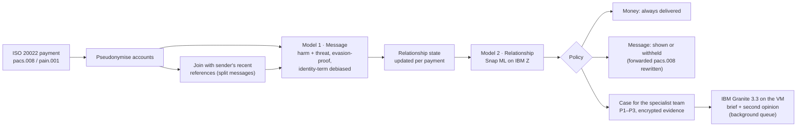

# SafePay: stopping abuse hidden in payment messages, in real time, on IBM Z

**IBM Z Datathon 2026 · Event code: SSF2026 · Theme 1: Real-Time AI for Critical Decisions** (with Theme 2: sensitive data stays on-platform)

> Submission title format: `[Team Name_IBM Z Datathon 2026 Project]`

## The problem

When a victim blocks an abuser on their phone and every social app, some abusers find the one channel that can't be blocked: **the victim's bank account**. They send one-cent payments with threats in the payment reference.

- **Commonwealth Bank of Australia** found about **1,500 high-risk cases a year**, and built and open-sourced a model to find them ([paper](https://arxiv.org/abs/2303.08016), [code](https://github.com/h2oai/aitd)). That model scores relationships **once a month**.
- **Westpac** reported blocking **24,000 payments from 19,000 customers** over abusive wording.
- **Santander** described a single threat spread **across nine transfers**, and admitted that banned-word lists don't stop determined senders ([report](https://todaysfamilylawyer.co.uk/santander-leads-ban-on-offensive-language-after-reports-that-abusers-are-using-banking-apps-to-send-death-threats/)).
- **Nationwide and Starling** now let customers hide abusive references ([FStech](https://www.fstech.co.uk/fst/Nationwide_Launches_Tool_To_Block_Abusive_Payment_Reference_Messages.php)).

Keyword filters are easy to evade, and monthly scoring leaves victims exposed for weeks. Most of the world's card and payment processing runs on IBM Z, so that's where screening every payment *as it happens* belongs.

## What SafePay does

SafePay is a screening service a bank puts in its payment flow. It reads real **ISO 20022** payment messages, either `pain.001` at the sender's bank or `pacs.008` at the recipient's bank (which protects a victim even if the abuser banks elsewhere). For every payment it returns a decision in about a millisecond.



| Part | What it does | Why it matters |
|---|---|---|
| **Message model** | TF-IDF (words + characters) with two logistic-regression heads: *harm* and *threat*. Trained on 260K real comments. | About 1 ms per message, and every flag points at the words that caused it |
| **Evasion handling** | Undoes `k.i.l.l`, `d3ad`, `k i l l`, Cyrillic look-alikes and 🔪 emoji before scoring | This is how abusers get past keyword lists |
| **Split messages** | Joins the sender's last references (within 30 minutes) and scores the whole sentence | The nine-transfer threat gets caught as a threat |
| **Relationship model** | 23 features updated in O(1) per payment: penny-payment share, night share, replies, bursts, an escalation detector (CUSUM), contact after the victim hid the sender… Random forest on **IBM Snap ML** | Catches polite-but-menacing coercive control that no text model can see |
| **Policy** | **Money is never blocked** (it may be child support). Only the message is withheld. **The sender is never told** once a case exists, because tipping off an abuser can escalate danger. No case on behaviour alone before 3 payments. | Built around victim-safety guidance, not just accuracy |
| **IBM Granite 3.3 2B** | Runs locally on the VM via llama.cpp. Writes a brief for the specialist team, and gives a **second opinion** reading the messages in context | "Saw you at the gym today" scores 0.02 as a toxic message; Granite reads the pattern as stalking |
| **Three views** | Sender's app (pre-send nudge), recipient's app ("Message hidden for your safety · View anyway · Get support", plus "hide messages from this sender"), analyst console (ranked queue, timeline, Granite brief, confirm/dismiss, audit log) | It's a product, not a notebook |

## Results

### Real-time vs monthly batch (synthetic test world, seed 5, never used for any decision)

4,400 relationships, 44,209 payments, 400 abusive. Message text is real (Civil Comments **test** split). The hand-written phrases are a third the models never saw. The baseline re-implements Commonwealth Bank's published method (monthly relationship aggregates, random forest) using **our** message model, so the difference comes from real-time relationship scoring.

| | **SafePay (real-time)** | CBA-style (monthly batch) |
|---|---|---|
| Abusive relationships caught | **390 / 400 (97.5%)** | 386 / 400 (96.5%) |
| False alarms in 6,374 innocent relationships | 0 | 0 |
| **Median time from first abusive payment to case** | **3.2 days** | **19.9 days** |
| Caught within 24 hours | **24.5%** | 1.0% |
| Abusive messages withheld *as they arrived* | **93.6%** | 0% (it only acts after the month) |
| Innocent messages withheld (soft hide; recipient can view) | 2.6% | 0% |

By type, SafePay caught 100% of harassment, split-threat and coercive-control relationships, 93% of abusive child-support payers and 87% of "low and slow" abusers (the monthly baseline caught 78% of those).

> **Read this honestly.** Zero false alarms is a property of a synthetic world we built, and real data will be harder. The comparison that should hold up is *timing*: scoring every payment as it arrives protects victims days or weeks sooner than a monthly batch, and withholds most abusive messages before they're ever seen.

### How we got here (development history, kept on purpose)

| Version | Test world | Precision | False alarms /10K innocent | What we found |
|---|---|---|---|---|
| v1 | seed 3 | 70% | 251 | The model memorised the exact scores of a few hand-written innocent phrases. Validation reused training phrases, so it looked perfect (F1 0.99) and hid this |
| v2 | seed 4 | 80% | 156 | Fixed with a three-way phrase split, a score floor and phrase variation. Then friends' banter tripped it, because the test phrases were ruder than the training ones |
| v3 | seed 5 | 100% | 0 | Broader banter in every split of the phrase lists. Median time to case 1.7 days |
| **final** | seed 5 | **100%** | **0** | Two realism rules prompted by the *live demo*, not by test scores: no behaviour-only case before 3 payments (one 1 a.m. penny payment scored 0.71), and references under 4 letters judged only as part of joined text ("I" scored 0.96 as a threat). They made test timing *worse* (median 1.7 → 3.2 days) and we kept them |

Seeds 3 and 4 were used for diagnosis. Seed 5 was evaluated twice, for v3 and for the final version, and the change between them was not chosen to improve its numbers. Every version's metrics are in `results/`.

### Message model on real held-out text (Civil Comments test split, payment-length texts ≤ 140 characters)

| Head | Texts | Positives | Precision | Recall | F1 | ROC AUC |
|---|---|---|---|---|---|---|
| Harm | 36,220 | 2,883 | 0.682 | 0.684 | 0.683 | 0.956 |
| Threat | 36,220 | 151 | 0.312 | 0.503 | 0.385 | 0.974 |

Threats are rare and hard to pin down from text alone. That's exactly why the relationship model and Granite exist.

**Evasion tricks** (applied to the 5,223 toxic test texts): recall is 67.0% clean, 61.3% after tricks without our canonicaliser, and **66.7%** with it, so it recovers about 95% of what the tricks take away.

**Fairness** (Jigsaw identity templates, never used for training). Our first model hid harmless messages just for mentioning a group:

| Harmless sentences mentioning… | Before identity masking | After |
|---|---|---|
| "gay" | **99.7%** flagged | 13.2% |
| "homosexual" | 96.8% | ≤ 13.2% |
| "black" | 88.6% | ≤ 13.2% |
| "muslim" | 76.2% | ≤ 13.2% |
| Toxic template sentences caught | 80.7% | **97.4%** |

13.2% is now the same as for any template sentence, so no identity term is singled out. It cost 0.013 F1 on real text.

## Why IBM Z / LinuxONE (measured on an IBM z17, machine type 9175)

| | Result |
|---|---|
| Full screening path in one process (message → joined → state → relationship → policy → SQLite write) | **699 payments/s**, median 0.31 ms, p99 7.4 ms |
| Same, over HTTP with real ISO 20022 XML | **549 requests/s**, median 0.81 ms, p99 7.3 ms |
| Relationship model, Snap ML compressed trees on CPU | **12 µs** per payment |
| Relationship model, Snap ML on the **on-chip AI accelerator** (zDNN) | 61 µs per payment |
| IBM Granite 3.3 2B, Q4_K_M, on the CPU's vector units, 3 threads | 11.8 prompt tokens/s, 1.34 generated tokens/s |

- **We measured instead of assuming.** The VM exposes the Telum II AI accelerator (`nnpa` in `/proc/cpuinfo`), and Snap ML's automatic choice picks it. For our small forest on this shared 3-core VM, the CPU engine was 5× faster, so the service uses whichever engine the benchmark measured as fastest (`artifacts/benchmark.json`). The accelerator path is one setting away for larger models.
- **Big-endian, natively.** The stack runs on Ubuntu's native s390x builds of numpy, SciPy and scikit-learn, because PyPI has no s390x wheels for them. Granite's GGUF file was converted to big-endian with llama.cpp's converter.
- **Toolchain notes we hit.** Ubuntu 24.04's GCC 13 can't target the z17 (`-march=arch15` needs GCC 15), so llama.cpp is built for z16, which the z17 runs natively. llama.cpp's own zDNN backend only accelerates FP16/FP32 models, and Granite in FP16 (~5 GB) doesn't fit beside everything else in 8 GB RAM, so Granite runs on the vector units.
- **Data never leaves the platform.** Models, Granite, the case store and the audit log all run on the same LinuxONE system. Account numbers are replaced by keyed HMAC tokens on arrival, and evidence is encrypted with AES-256-GCM, bound to its case. There's no external AI API.
- **Containerised.** The `Containerfile` builds an s390x image with Podman.
- **Granite stays off the payment path.** At 1.3 tokens/s on 3 shared cores, a brief takes 1–2 minutes, so Granite runs in a background queue, and is re-run when a case escalates to P1.

## What is real and what is simulated

| Real | Simulated (and why) |
|---|---|
| ISO 20022 pacs.008 / pain.001 parsing and the forwarded message | The bank itself: no hackathon can connect to one, so SafePay speaks the industry format |
| Message text: 1.14M real short comments (Civil Comments, CC0) | **Abusive relationship timelines.** No public dataset of real abusive payments exists, and one shouldn't, because it would expose victims. Patterns follow what banks have published |
| Live demo input: whatever you type is screened by the real service | Customer names and accounts (fictional) |
| Snap ML, zDNN, Granite and llama.cpp running on the z17 | Hand-written payment-style, banter, coercive and debt-reminder phrases, split in thirds across train/validation/test |

## Run it

On a LinuxONE Community Cloud VM (Ubuntu 24.04, s390x). Civil Comments comes as Parquet, and pyarrow has no s390x build, so convert it once on any other machine with `python -m safepay.scripts.convert_parquet <parquet dir> data/`, then copy `cc_*.csv` to `data/`.

```bash
bash setup_safepay.sh      # packages, train, evaluate, build llama.cpp, convert Granite, tests
bash run_safepay.sh        # Granite on :8081, SafePay on :8090
python3 -m safepay.scripts.benchmark --url http://127.0.0.1:8090 --granite
```

From your laptop:

```bash
ssh -N -L 8090:127.0.0.1:8090 linux1@<vm-ip>
```

Then open http://localhost:8090 (live demo), `/analyst` (specialist console) and `/system` (every number above, read from the training and benchmark outputs).

Container: `podman build -t safepay -f Containerfile . && bash run_safepay.sh container`

Tests: `python3 -m pytest -q tests_safepay` (19 tests; the end-to-end one needs trained models).

### API

| Endpoint | Who calls it |
|---|---|
| `POST /v1/screen` | Payment flow: body is an ISO 20022 `pacs.008` or `pain.001`. Returns per transaction: decision, scores, reasons, case, latency, and the `pacs.008` to forward |
| `POST /v1/presubmit` | Sender's app before sending: `{nudge, message}`. Never reveals that a case exists |
| `POST /v1/recipients/hide` | Recipient's app: hide messages from this sender |
| `GET /v1/cases`, `GET /v1/cases/{id}` | Analyst console (decrypts evidence and writes the audit log) |
| `POST /v1/cases/{id}/label` | Confirm or dismiss, stored as labels for retraining |
| `GET /healthz`, `GET /metrics` | Operations (Prometheus text format) |

## Project layout

```
safepay/core/iso20022.py    parse/build pacs.008 and pain.001, rewrite the reference
safepay/core/normalize.py   undo evasion tricks
safepay/core/textmodel.py   Model 1: harm + threat heads, identity-term masking
safepay/core/state.py       per-relationship state, split-message buffer, CUSUM
safepay/core/engine.py      shared scoring path for training, evaluation and the service
safepay/core/relmodel.py    Model 2 on Snap ML (CPU or AI accelerator)
safepay/core/policy.py      decisions: deliver, hide, case, nudge
safepay/core/screener.py    the live service pipeline
safepay/core/privacy.py     HMAC tokens, AES-GCM evidence
safepay/core/store.py       SQLite: states, cases, evidence, hides, labels, audit
safepay/core/granite.py     IBM Granite briefs and second opinions (background)
safepay/sim/world.py        synthetic payment worlds
safepay/scripts/            convert_parquet, train_text, train_rel, benchmark
safepay/app/                FastAPI service + demo, analyst and evidence pages
agentguard/                 our earlier prototype (AI-assistant firewall), kept as a fallback
```

## Limitations and next steps

- **Synthetic relationships.** The next step is a pilot on a bank's own (consented, pseudonymised) payment logs, with the analyst labels SafePay already collects feeding retraining.
- **English only.** CBA's paper lists other languages as an open gap, and Granite's multilingual support is the natural route.
- **Granite's second opinion is not yet evaluated at scale.** At 1–2 minutes per case on 3 cores we didn't get a statistically meaningful sample in the event window.
- **The split-message window is 30 minutes, and evidence before a case opens is limited to that window.** A bank would attach full payment history.

## Data and open-source software

| | Licence |
|---|---|
| [google/civil_comments](https://huggingface.co/datasets/google/civil_comments) | CC0-1.0 |
| [conversationai/unintended-ml-bias-analysis](https://github.com/conversationai/unintended-ml-bias-analysis) (bias templates) | Apache-2.0 |
| [IBM Granite 3.3 2B Instruct GGUF](https://huggingface.co/ibm-granite/granite-3.3-2b-instruct-GGUF) | Apache-2.0 |
| [llama.cpp](https://github.com/ggml-org/llama.cpp) | MIT |
| [IBM zDNN](https://github.com/IBM/zDNN) | Apache-2.0 |
| [IBM Snap ML](https://snapml.readthedocs.io/) | Free IBM licence (not open source) |
| [scikit-learn](https://github.com/scikit-learn/scikit-learn), [NumPy](https://github.com/numpy/numpy), [SciPy](https://github.com/scipy/scipy), [pandas](https://github.com/pandas-dev/pandas), [joblib](https://github.com/joblib/joblib) | BSD-3 |
| [FastAPI](https://github.com/fastapi/fastapi), [Pydantic](https://github.com/pydantic/pydantic), [pytest](https://github.com/pytest-dev/pytest) | MIT |
| [Uvicorn](https://github.com/encode/uvicorn), [HTTPX](https://github.com/encode/httpx) | BSD-3 |
| [cryptography](https://github.com/pyca/cryptography) | Apache-2.0 / BSD |
| [Apache Arrow (pyarrow)](https://github.com/apache/arrow), used once to convert Parquet | Apache-2.0 |
| [Podman](https://github.com/containers/podman) | Apache-2.0 |
| [IBM Plex](https://github.com/IBM/plex) fonts | OFL-1.1 |
