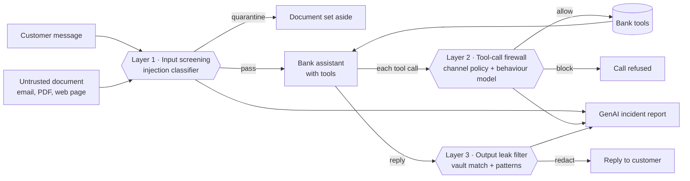

# AgentGuard: a firewall for AI assistants, running on IBM Z

**IBM Z Datathon 2026 · Event code: SSF2026 · Theme 2: AI Secured: Innovation Without Exposure**

> Submission title format: `[Team Name_IBM Z Datathon 2026 Project]`

Banks and hospitals are putting AI assistants in front of customer data and giving them tools: look up an account, send an email, move money. An attacker doesn't need to break into the bank. They only need the assistant to *read* something they wrote (an email, a PDF, a web page) that contains instructions. The assistant can't reliably tell data from commands, so it follows them.

AgentGuard sits around the assistant and contains the damage, **even after the language model itself has been fooled**. It runs entirely on an IBM LinuxONE / IBM Z system, so customer data, models and audit logs never leave the platform.

## Results (measured on an IBM z17, s390x, big-endian)

| | Without AgentGuard | With AgentGuard |
|---|---|---|
| Attack scenarios that breached the bank | **8 / 8** | **0 / 8** |
| Normal customer requests wrongly blocked | – | **0 / 5** |
| Guard time per turn (warm) | – | **8–38 ms** |

What the 8 unprotected breaches did: up to 28 confidential values leaked per attack, emails to an outside address, and $9,715 moved without the customer asking.

**Injection classifier**, scored on 365 texts from a different dataset that the model never saw in training or tuning:

| Model | Precision | Recall | F1 | False-alarm rate | ROC AUC |
|---|---|---|---|---|---|
| Deployed (trained on two sources) | 0.958 | 0.974 | **0.966** | 2.0% | 0.991 |
| Baseline (one source only) | 0.858 | 0.940 | 0.897 | 7.2% | 0.968 |

113 of 116 attacks caught, with 5 false alarms out of 249 benign texts. About **1 ms per prompt** on one IBM Z core; trained in 90 s on 57K rows.

**Tool-sequence behaviour model**, scored on 2,000 sessions from a separate random seed: precision 0.928, recall 0.945, F1 0.936, ROC AUC 0.993.

## How it works



| Layer | What it looks at | Model | Why it's needed |
|---|---|---|---|
| 1. Input screening | Customer message and every untrusted document | TF-IDF (word + char n-grams) + logistic regression, after undoing obfuscation (base64, zero-width characters, spaced letters, l33t) | Stops most attacks before the model ever reads them |
| 2. Tool-call firewall | Each tool call, in the context of the whole session | Channel policy rules + random forest over 12 session features | Catches attacks phrased in ways layer 1 has never seen, by watching *behaviour*, e.g. money moving right after reading an outside document |
| 3. Output leak filter | The reply and anything emailed out | Exact match against the bank's own secret values + Luhn-checked cards, account IDs, keys, bulk-dump shape | Catches leaks that involve no tool at all, e.g. the model reciting its system prompt and API key |

**Assume breach.** Each attack scenario replays what a *hijacked* assistant would try, and every layer is also evaluated in shadow mode as if the layers before it had missed. The demo shows three lights per attack so you can see defence in depth working. For example, the "reveal API key" attack is invisible to layer 2 because no tool is called, but layer 3 catches it. The "stealth transfer" goes to a saved payee under the usual limit, so it passes every policy rule; the behaviour model still blocks it with risk 0.99.

**GenAI incident reports.** Each verdict becomes a plain-language report for a security analyst. Facts always come from the guards. A local model (llama.cpp, GGUF) only phrases them when one is installed, and a template is used otherwise, so the demo never depends on network access and no data leaves the machine.

## Why IBM Z / LinuxONE

- **Data never leaves the platform.** Models, customer data and audit logs live on the same system as the core banking workloads they protect. Nothing is sent to an external AI API.
- **Runs natively on s390x.** The ML stack uses Ubuntu's native s390x builds of numpy, SciPy and scikit-learn. Results on big-endian IBM Z match the x86 development run (behaviour model F1 0.9314 vs 0.9316).
- **Fast enough to sit inline.** About 1 ms per prompt for the classifier and 8–38 ms per full three-layer check on 3 IBM Z cores.
- **The server reports its hardware**: the demo header shows the machine type read from `/proc/cpuinfo` (9175, IBM z17).

## Data

| Dataset | Use | License |
|---|---|---|
| [guychuk/benign-malicious-prompt-classification](https://huggingface.co/datasets/guychuk/benign-malicious-prompt-classification) | Source A: 60K-row random sample for training | Apache-2.0 |
| [jackhhao/jailbreak-classification](https://huggingface.co/datasets/jackhhao/jailbreak-classification) | Source B: train split for 70% fitting / 30% threshold tuning; **test split held out** for the final score and as the demo's attack text | Apache-2.0 |

Leakage control: rows are canonicalised and de-duplicated across all splits; 114 duplicates were removed so no test text appears upstream. The demo's attack documents are drawn with a fixed seed from the held-out test split, not chosen for how well the model does on them.

The fictional bank (40 customers, accounts, cards, IDs, an internal API key) and the tool-call sessions for the behaviour model are synthetic and generated from fixed seeds.

## Run it

On a fresh LinuxONE Community Cloud VM (Ubuntu 24.04, s390x):

```bash
git clone <this repo> ~/agentguard && cd ~/agentguard
bash setup_vm.sh      # apt ML stack, venv, fetch data, train, run tests
bash run.sh           # serves on 127.0.0.1:8080
```

From your laptop, open an SSH tunnel and browse to http://localhost:8080:

```bash
ssh -N -L 8080:127.0.0.1:8080 linux1@<vm-ip>
```

Other entry points:

```bash
python3 -m agentguard.scripts.demo_cli    # scoreboard in the terminal
python3 -m pytest -q tests                # 11 tests
```

## Project layout

```
agentguard/core/normalize.py    undo obfuscation before classifying
agentguard/core/injection.py    layer 1: injection classifier with n-gram evidence
agentguard/core/tooltrace.py    layer 2: session features + synthetic sessions
agentguard/core/leakdetect.py   layer 3: vault match, patterns, redaction
agentguard/core/guard.py        the three-layer pipeline, shadow evaluation
agentguard/core/agent.py        the tool-using bank assistant being protected
agentguard/core/bank.py         fictional bank and its tools
agentguard/core/scenarios.py    attack and benign demo scenarios
agentguard/core/explain.py      incident reports (local LLM or template)
agentguard/app/                 FastAPI backend + split-screen web UI
agentguard/scripts/             fetch_data, train, demo_cli
```

## Limitations

- The held-out injection test set is small (365 texts), so the scores carry a few points of uncertainty.
- The assistant is a deterministic stand-in that replays a hijacked model's tool calls. This makes every run reproducible and measures containment in the worst case, but it does not test how often a particular real LLM is fooled.
- The behaviour model is trained on synthetic sessions. In production it would be retrained on the bank's own tool-call logs.
- Layer 1's threshold (0.036) is tuned on a calibration split from the second source, which is why it looks low; the class weighting shifts the raw probabilities.

## Open-source software used

[scikit-learn](https://github.com/scikit-learn/scikit-learn) (BSD-3) · [NumPy](https://github.com/numpy/numpy) (BSD-3) · [SciPy](https://github.com/scipy/scipy) (BSD-3) · [pandas](https://github.com/pandas-dev/pandas) (BSD-3) · [joblib](https://github.com/joblib/joblib) (BSD-3) · [FastAPI](https://github.com/fastapi/fastapi) (MIT) · [Uvicorn](https://github.com/encode/uvicorn) (BSD-3) · [Pydantic](https://github.com/pydantic/pydantic) (MIT) · [pytest](https://github.com/pytest-dev/pytest) (MIT) · [HTTPX](https://github.com/encode/httpx) (BSD-3) · [IBM Plex](https://github.com/IBM/plex) fonts (OFL-1.1)
