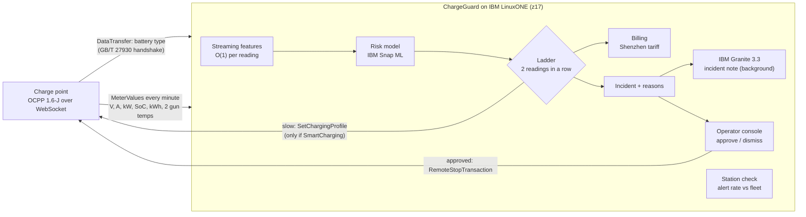

# ChargeGuard: early warning of hazardous EV charging, inside the charging transaction, on IBM Z

**IBM Z Datathon 2026 · Event code: SSF2026 · Wildcard: Beyond the Obvious** (with Theme 1: real-time decisions, and Theme 2: driver data stays on-platform)

> Submission title format: `[Team Name_IBM Z Datathon 2026 Project]`

## The problem

A lithium-ion battery that is going wrong often shows it while it charges: heat that doesn't match the current, voltages that wander, energy that doesn't match the charge level. Charging is also the one moment when the battery is connected to a system that can **see it every minute and act**: the charging network's central system already authorises, meters and bills every charge.

- China's emergency-management ministry reported **640 new-energy-vehicle fires in Q1 2022, up 32%** ([IT之家](https://www.ithome.com/0/624/143.htm)), and the market regulator's recall centre has counted **more than 1,730 NEV fires from 2018 to November 2024** ([Xinhua](http://www.news.cn/fortune/20241128/48625d8978cb4398925050bcba594450/c.html)).
- Media-report tallies put roughly **a quarter of reported NEV fires during charging** ([China Securities Journal](https://www.cs.com.cn/cj2020/202501/t20250118_6469631.html), citing the 2024 NEV insurance report). These are media tallies, not official statistics.
- Chargers already have a hard over-temperature trip. On real data (below), a temperature cut-off set to the same false-alarm budget catches **2%** of faulty-battery sessions.

> **What ChargeGuard is, and isn't.** It is an *early warning of potentially hazardous charging anomalies*, trained on sessions that the dataset's authors labelled as coming from faulty batteries. The labels are faults, not fires: nobody has published a link between these labels and fire outcomes, so we don't claim ChargeGuard predicts or prevents fires.

## What ChargeGuard does

ChargeGuard is a screening service inside the charging network's central system (CSMS). It speaks **OCPP 1.6-J**, the protocol real chargers use, and screens every one-minute `MeterValues` reading of every charge.



| Part | What it does | Why it matters |
|---|---|---|
| **OCPP 1.6-J central system** | WebSocket endpoint for charge points: BootNotification, StartTransaction, MeterValues, StopTransaction. Battery chemistry arrives as `DataTransfer` from the GB/T 27930 handshake that Chinese DC chargers perform. It asks each charger `GetConfiguration(SupportedFeatureProfiles)` before sending any command | It plugs into the protocol chargers already speak. Smart charging is *optional* in OCPP 1.6, so ChargeGuard checks before it tries |
| **Streaming features** | 33 features updated in O(1) per reading: temperature rise over 5 minutes, temperature slope, rise per kW, sensor disagreement, voltage and current steadiness, charge level. The **same code** builds the training set and runs in the service | No train/serve mismatch |
| **Behaviour-only risk model** | Gradient-boosted trees on **IBM Snap ML** (23 features). Vehicle-size levels (pack voltage, power, current level, kWh per % of charge) are deliberately left out (see Results) | It judges how a charge behaves, not how big the vehicle is |
| **Decision ladder** | continue → watch → **slow** (cap current to 50% with `SetChargingProfile`, automatic, only on SmartCharging chargers; otherwise escalated to an operator) → **stop recommended** (incident opens; the charge continues until an operator approves, then `RemoteStopTransaction`). A level needs 2 readings in a row and minute ≥ 3; levels never step down in a session | One noisy reading never changes a charge, and no charge is ever stopped by the model alone |
| **Plain-language reasons** | "gun temperature (sensor 1) rose 9 °C in the last 5 minutes; 99% of normal charges stay under 3 °C". Each reason quotes the normal percentile the value actually crosses | Operators see *why*, in units they know |
| **IBM Granite 3.3 2B** | Runs locally on the VM through llama.cpp. Writes a three-sentence incident note for station staff from the facts. A template note appears instantly; Granite's replaces it when ready | Granite never decides anything, and a slow LLM never delays a safety action |
| **Station check** | A charger that slows more than 10% of its last 50 sessions *and* more than 3× the median of the other chargers is flagged: "check this charger's sensors before trusting its alerts" | Found on real data: three stations' temperature sensors read differently (below) |
| **Privacy, billing, audit** | Driver `idTag`s are replaced by HMAC-SHA256 pseudonyms. Each charge is billed with Shenzhen's hourly tariff (electricity + service fee, from UrbanEV). Every approval, dismissal and command is in an audit log | Driver data stays on the platform, and every action is traceable |

## Data

| Dataset | Used for | Size |
|---|---|---|
| [Shenzhen EV charging, PolyU + Autosun](https://data.mendeley.com/datasets/c7gg94tmvz) (Mendeley, CC BY 4.0) | Risk model, evaluation, live replay | 1,382,319 one-minute readings, **18,531 sessions, 747 faulty**, 30 public stations, Oct 2020 – Oct 2023 |
| [Tsinghua EV battery fault data](https://doi.org/10.6084/m9.figshare.23659323) (figshare, CC BY 4.0) | Vehicle-health study (see below) | Brands 2 and 3: 147 cars, 25 faulty, 223,833 charging snippets with cell-level voltages |
| [UrbanEV](https://github.com/IntelligentSystemsLab/UrbanEV) (CC0) | Shenzhen charging price by hour (CNY/kWh) | 1.6–1.7 CNY/kWh |

The Shenzhen data comes with the authors' paper: Yang et al., *Privacy-preserving collaborative battery fault warning for massive electric vehicles by heterogeneous data from charging stations*, Nature Communications 17:974 (2025), [doi:10.1038/s41467-025-67703-7](https://doi.org/10.1038/s41467-025-67703-7). The paper does not describe how labels were assigned. In the file, the label is constant within a session, so we treat it as a session label.

## Results

All numbers below come from one run on the LinuxONE VM (IBM z17, Snap ML), in [`results/metrics.json`](results/metrics.json).

**Evaluation design.** Six stations that have both normal and faulty sessions were picked at random (fixed seed) and locked away as the test set: **5,070 sessions, 235 faulty**. Everything else (model, thresholds, which stations need a hardware check) is decided on the other 24 stations, using 5-fold cross-validation **grouped by station**. Each level's threshold is the score that a fixed share of normal training sessions ever reaches (5% watch, 2% slow, 0.5% stop). Every minute of every test session is then scored exactly as the live service sees it. Confidence intervals are 95% session bootstraps.

### Held-out stations

| | **ChargeGuard** (behaviour-only) | Gun-temperature cut-off, same budgets | All-features model (comparison) |
|---|---|---|---|
| ROC-AUC per session | **0.959** | 0.567 | 0.973 |
| ROC-AUC using only the first **5 minutes** | **0.947** | 0.490 | 0.970 |
| Faulty sessions reaching **stop recommended** | **89%** (86–93%) | 2% | 88% |
| Precision of stop recommendations | 37% (33–41%) | 4% | 57% |
| Normal sessions reaching stop recommended | 75 per 1,000 (67–82) | 22 per 1,000 | 32 per 1,000 |
| Faulty sessions **slowed** | **93%** (90–96%) | 10% | 92% |
| Normal sessions slowed | 153 per 1,000 (143–163) | 58 per 1,000 | 78 per 1,000 |
| Median minute a faulty session is first slowed | **3** (the earliest the ladder allows) | 55 | 3 |

At the median, ChargeGuard reaches "stop recommended" before 95% of a faulty session's energy has gone into the pack.

### Typical cars (apparent pack under 90 kWh): the honest headline

Faulty sessions in this dataset are concentrated in large packs (next section). For sessions under 90 kWh, where the model can't lean on vehicle size, there are **4,678 test sessions with 82 faulty**:

| | ChargeGuard | Temperature cut-off | All-features model |
|---|---|---|---|
| ROC-AUC per session | **0.904** | 0.299 | 0.920 |
| ROC-AUC, first 5 minutes | **0.889** | 0.320 | 0.914 |
| Faulty sessions reaching stop recommended | **79%** (71–88%) | 1% | 66% |
| Precision of stop recommendations | 16% (13–20%) | 1% | 26% |
| Normal sessions reaching stop recommended | 73 per 1,000 | 21 per 1,000 | 33 per 1,000 |

> **Read this honestly.** ChargeGuard ranks charges well from the first few minutes (AUC 0.89–0.95), and a temperature trip is no substitute (worse than chance for typical cars). But at these thresholds, **most stop recommendations for typical cars are false** (precision 16%), and too many normal charges are slowed. That is why a stop always needs an operator, and why "slow" caps the current instead of cutting it. Most of the false alarms come from two stations (below), which is a calibration problem we have not solved.

### Vehicle size is a confounder, so the served model leaves it out

| Apparent pack size (kWh per 1% of charge × 100) | Sessions | Faulty |
|---|---|---|
| Under 90 kWh (typical cars) | 17,075 | 1.9% |
| 90–150 kWh | 1,124 | 10.3% |
| **Over 150 kWh** | 313 | **95.8%** |

Pack size alone scores ROC-AUC 0.83 on the test stations. Either faulty batteries in this fleet are mostly large commercial vehicles, or "energy that doesn't match the charge level" is itself the fault (the paper lists capacity abnormalities). The data can't tell us which. So the served model uses **behaviour only**, and the all-features model is kept only as a comparison. It scores higher overall, but recommends stops for fewer typical-car faults (66% vs 79%).

### What the model actually relies on

Half of the model's split importance (48%, Snap ML) is the **gap between the charging gun's two temperature sensors**. In faulty-battery sessions, sensor 1 runs almost as hot as sensor 2 (median gap about 1 °C, against about 7 °C in normal charges). Then come the gun temperatures themselves, temperature rise per kW, and how steady the current and voltage are.

Gun sensors measure the **connector**, not the cells. So ChargeGuard's signal is a connector-level pattern that, on stations it never saw, lines up with the authors' battery-fault labels. It isn't a direct battery measurement. It's also why chargers whose sensors are laid out differently confuse it (stations 3, 10 and 20, below). A charging network that also forwards the battery management system's cell data (GB/T 27930 reports highest cell voltage and temperature) would give the model a far more direct signal.

### By battery chemistry and by station

| Chemistry (test) | Sessions | Faulty | ROC-AUC | Stop recommended: faulty caught | Normal per 1,000 |
|---|---|---|---|---|---|
| LFP | 3,162 | 185 | 0.967 | 91% (87–95%) | 77 |
| NMC | 1,843 | 50 | 0.927 | **82% (70–92%)** | 73 |

| Test station | Sessions | Faulty | ROC-AUC | Faulty caught (stop) | False stop recommendations per 1,000 normal | Station check flags it after |
|---|---|---|---|---|---|---|
| 1 | 720 | 13 | 0.704 | 54% | 4 | 26 sessions |
| 3 | 891 | 103 | 0.941 | 90% | **211** | 21 sessions |
| 10 | 865 | 28 | 0.972 | 96% | **217** | 20 sessions |
| 14 | 968 | 39 | 0.976 | 92% | 0 | never |
| 16 | 683 | 48 | 0.998 | 90% | 2 | 217 sessions |
| 18 | 943 | 4 | 0.997 | 4 of 4 | 12 | never |

**Four of six stations stay near the false-alarm budget; two don't.** Stations 3 and 10 read their two gun temperature sensors differently from the rest of the fleet (median sensor-2 minus sensor-1: −11 °C and +4 °C; the other stations read +6 to +14 °C). Training station 20 is the same story (+1 °C). The label-free station check (a charger that slows more than 10% of its last 50 sessions *and* more than 3× the median of the other chargers) flags 3 and 10 after 20–21 sessions. But it also flags station 1 after 26 sessions and station 16 after 217, so it can't yet tell a sensor quirk from a run of genuinely faulty cars: it's a prompt for a technician, not a fix.

### How we got here (development history, kept on purpose)

| Version | Change | What we found |
|---|---|---|
| v0 | All features; thresholds = one quantile pooled over all training stations | Test ROC-AUC 0.97, but **0 of 50 NMC faults** slowed. Cause: station 20's 480 normal sessions scored like faults and pushed the thresholds out of reach |
| v0.1 | Thresholds = median of per-station quantiles | NMC recovered, but false stop recommendations rose to 44 per 1,000 |
| v0.2 | Two steps: flag outlier stations (20), then pooled thresholds over the rest | Stop recall 88%, 31 false per 1,000. Kept |
| **v1** | Removed vehicle-size features after the live demo's top "reason" turned out to be pack size | Typical-car ROC-AUC 0.90 (vs 0.92 with size). **Served** |
| v1.1 | Station check made fleet-relative after the live demo (25% faulty mix) flagged every charger with the absolute rule | On the test stations: flags 4 of 6 instead of 6 of 6. Model unchanged |
| v2 | Gun temperatures relative to each charger's own rolling baseline | Cross-validation on training stations: false stops 48 → 15 per 1,000, but stop recall 0.80 → 0.50. **Rejected** by a rule fixed before the run (recall may drop at most 0.05) ([`results/dev/`](results/dev/)) |

v0–v2 were developed on the laptop (scikit-learn), and only v1 was rerun on the z17. **The locked-away test stations were evaluated at every step**, and the changes to v0.1, v0.2 and v1 were prompted by problems we saw there (the NMC gap, size-based reasons), although each fix was designed and checked on training stations. So these test numbers are less clean than a single untouched evaluation. The v2 decision used cross-validation only.

**Compared with the dataset's authors.** Yang et al. report average fault recall 73.6% and F1 57.8 (accuracy 92.4%) for their federated model. Their split appears to be by position within each data owner's records, not by station, so the numbers aren't directly comparable with our station-held-out evaluation.

## Vehicle health across charges (exploratory)

The Shenzhen data has no vehicle IDs, so it can't show a battery getting worse over weeks. The Tsinghua data can: charging snippets with **cell-level** voltages and temperatures, labelled per car (drivers' reports confirmed by engineers). We asked whether a car's history across charges flags a faulty battery, testing on cars held out of training ([`results/vehicle_metrics.json`](results/vehicle_metrics.json), trained on the z17, `chargeguard/scripts/train_vehicle.py`).

| Held-out cars (20 × 5-fold over cars) | ROC-AUC (95% CI) |
|---|---|
| Brand 3: 100 cars, 9 faulty | 0.83 (0.72–0.93) |
| Brand 3, usage only (mileage, current, charge range) | 0.81 (0.72–0.89) |
| Brand 2: 47 cars, 16 faulty | 0.90 (0.77–0.98); 0.74 (0.57–0.88) after adjusting for mileage |
| Using only the first half of each car's mileage history | 0.85 (brand 3), 0.82 (brand 2) |
| **Trained on one brand, tested on the other** | **0.42 and 0.63** |

> **Read this honestly.** Cars can be ranked within a brand, but the signal doesn't transfer between brands, and in brand 3 how a car is used explains most of it. "Growing cell-voltage spread" holds in brand 2 only. The samples are tiny (25 faulty cars), so this is evidence for collecting per-vehicle history, not a feature we'd deploy. It is not part of the live decision ladder.

## Why this belongs on IBM Z

Every charge is already a transaction: authorised, metered every minute, billed. The screening belongs in the same path, on the platform built for that kind of workload.

Measured on the LinuxONE Community Cloud VM (**IBM z17**, machine type 9175, 3 vCPUs), from [`results/benchmark.json`](results/benchmark.json):

| | Per reading, one at a time | Per reading, batched |
|---|---|---|
| Snap ML on the CPU (`compress_trees`) | **12.5 µs** | 1.8 µs |
| Snap ML on the z17's on-chip AI accelerator (`zdnn_tensors`) | 111 µs | 9–18 µs |
| **Full ChargeGuard pipeline** (features, model, ladder, reasons, SQLite) | **94 µs median**, 1,199 µs p99 | |
| IBM Granite 3.3 2B incident note (50 tokens, cached instructions) | 41 s (1.2 tokens/s) | |

Both engines give identical predictions. For a model this small, the CPU path is faster, so the service uses it. In the live demo the same machine also runs Granite on all 3 cores, the replay and the dashboard, so the per-reading time on the dashboard is higher than in this isolated benchmark. The accelerator pays off for larger models and batches, so ChargeGuard lets Snap ML choose (`auto`). One core screens **about 5,500 readings a second**. At one reading per minute, that's about **330,000 charging connectors per core**.

- **Theme 2:** driver identities are pseudonymised before storage, and the model, Granite and the data all run on the same LinuxONE. Nothing leaves the platform.
- **Next step on IBM Z:** the authors' setting has 8 charging operators that can't share data. [IBM Secure Execution for Linux](https://www.ibm.com/docs/en/linuxonibm/ldva/ldva_c_secex.html) could host a shared ChargeGuard that no operator, or the platform administrator, can look inside. We have not built this.

## Responsible AI

- **No fire claims.** The labels are faults, and that's what we report.
- **People decide stops.** The model can only slow a charge (current capped at 50%), and only on chargers that support it. A stop needs an operator's approval, recorded in the audit log.
- **Slow before stop, persistence, no flapping.** Two readings in a row, never before minute 3, and levels never step down.
- **Fairness across chemistries and stations** is reported with confidence intervals, including where it's weak (NMC, station 1).
- **The vehicle-size confounder is designed out**, and stations with odd sensors are surfaced rather than hidden.
- **Granite writes notes, never decisions**, and is told not to claim a confirmed fault or a fire.

## Run it

On a LinuxONE Community Cloud VM (Ubuntu 24.04, s390x):

```bash
bash setup_chargeguard.sh       # packages, data, tariff, training on Snap ML, tests, benchmark
bash run_chargeguard.sh demo    # service on 127.0.0.1:8095 + replay of the held-out stations
```

From your laptop, open a tunnel and browse to http://localhost:8095 (live operations) and http://localhost:8095/evidence (results):

```bash
ssh -N -L 8095:localhost:8095 ibmz
```

The replay (`python -m chargeguard.sim.replay`) runs one simulated OCPP charge point per held-out station, with 4 connectors each, and one charge point without SmartCharging. The demo mix raises faulty sessions to 25% (the real rate is 4.6%) so they show up often; `--fault-share 0` replays sessions in recorded order. **The charge points are simulated, and ChargeGuard has not been tested with, or certified for, real chargers.**

Tests: `python -m pytest -q tests` (13 tests, including a full OCPP WebSocket flow that checks nothing is stopped without approval).

## Project layout

```
chargeguard/core/features.py   streaming features, shared by training and the service
chargeguard/core/model.py      Snap ML on IBM Z (CPU or AI accelerator), scikit-learn elsewhere
chargeguard/core/policy.py     decision ladder, thresholds from false-action budgets, station check
chargeguard/core/ocpp.py       OCPP 1.6-J messages
chargeguard/core/screener.py   per-session live state, actions, incidents
chargeguard/core/explain.py    plain-language reasons
chargeguard/core/granite.py    incident notes from IBM Granite (background)
chargeguard/core/privacy.py    HMAC pseudonyms
chargeguard/core/tariff.py     Shenzhen charging price
chargeguard/core/store.py      SQLite: sessions, decisions, incidents, audit
chargeguard/app/               FastAPI central system: OCPP endpoint, operator API, pages
chargeguard/sim/replay.py      simulated OCPP charge points replaying held-out stations
chargeguard/scripts/           prepare_data, fetch_tariff, train, benchmark,
                               convert_vehicle + train_vehicle (Tsinghua, exploratory)
results/                       metrics, examples, benchmark (from the z17 run)
```

## Limitations and next steps

- **Calibration to unfamiliar chargers.** Two of six test stations get far too many false alarms because their sensors read differently. Our charger-relative attempt (v2) lost too many faults. A better route is likely a short "shadow" period for each new charger before ChargeGuard acts on it.
- **Session labels, not fault onset.** The labels mark whole sessions, so we can measure how early a faulty session is flagged, but not how long before a hazard.
- **One city, one operator group, 2020–2023.** Other fleets, climates and charger models need their own evaluation.
- **The simulator replays recorded readings.** When ChargeGuard caps the current, the replay can't show how the battery would have responded.
- **Granite's notes are not evaluated** beyond reading them, and a 2B model sometimes blurs terms (e.g. "gun battery temperature"). The reasons and the template note beside each incident are the authoritative facts.
- **Granite is slow on this VM.** About 1.2 tokens a second on 3 shared cores, so a 50-token note takes ~40 s (fixed instructions are cached and only the incident's facts are processed). When the 8 GB VM is short of memory, Linux evicts parts of the model file and notes slow to minutes. That's why notes are written in the background, newest incident first, and never hold up a decision.

## Data and open-source software

| | Licence |
|---|---|
| [Shenzhen EV charging dataset](https://data.mendeley.com/datasets/c7gg94tmvz) (Yang, Tian, Mai, Chung; PolyU and Autosun) | CC BY 4.0 |
| [Tsinghua EV battery fault dataset](https://doi.org/10.6084/m9.figshare.23659323) (Zhang et al., Nature Communications 2023) | CC BY 4.0 |
| [UrbanEV](https://github.com/IntelligentSystemsLab/UrbanEV) | CC0 |
| [IBM Granite 3.3 2B Instruct GGUF](https://huggingface.co/ibm-granite/granite-3.3-2b-instruct-GGUF) | Apache-2.0 |
| [llama.cpp](https://github.com/ggml-org/llama.cpp) | MIT |
| [IBM Snap ML](https://snapml.readthedocs.io/) | Free IBM licence (not open source) |
| [IBM zDNN](https://github.com/IBM/zDNN) | Apache-2.0 |
| FastAPI, uvicorn, websockets, scikit-learn, pandas, NumPy | MIT / BSD |
